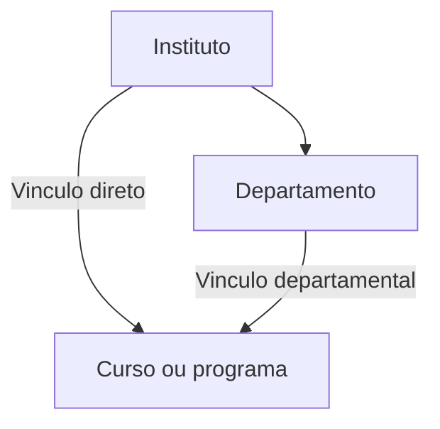

# Estrutura academica, convites, publicacoes e backup — 2026-11-07

## O que foi implementado e onde conferir

| Pedido | Comportamento entregue | Onde verificar |
| --- | --- | --- |
| Institutos e departamentos | CRUD administrativo de institutos e departamentos; cada departamento pode ser vinculado a um instituto. | Menu **Estrutura academica**, abas **Institutos** e **Departamentos**. |
| Cursos e programas | Um curso ou programa pode pertencer diretamente a um instituto ou a um departamento desse instituto. Os dois vinculos nao podem ser usados simultaneamente. | Aba **Cursos e programas**, campos **Tipo** e **Vinculo academico**. |
| Convite que nao aparece | O envio por e-mail cria ou reutiliza o cadastro imediatamente. A lista distingue **Aguardando definicao de senha**, **Ativo** e **Inativo**. | **Usuarios**, envio de convite e busca pelo e-mail do convidado. |
| UX do link de e-mail | Cadastro com e-mail vinculado ao convite, requisitos de senha marcados ao digitar, confirmacao em tempo real e mostrar/ocultar senha. | Abrir o link do e-mail em uma sessao sem login. |
| Historico e atas | Consulta paginada de versoes oficiais, conteudo arquivado, responsavel, referencia/data da ata e data/hora real da publicacao. | Disciplina publicada → **Historico e atas** → **Ver ementa e detalhes da ata**. |
| Reutilizar codigo existente | A busca abre os dados salvos em um rascunho; o formulario ou documento recebido nao substitui automaticamente o conteudo existente. | **Cadastrar/Importar** → informar codigo → **Buscar disciplina pelo codigo**. |
| Proteger o trabalho de outro professor | Apenas o responsavel pode alterar, descartar ou publicar seu rascunho. Outra pessoa recebe conflito e orientacao. | Abrir a mesma disciplina com duas contas diferentes. |
| Backup | Workflow no repositorio privado indicado, exportacao por SSH do Dokku, criptografia age e retencao dos tres snapshots completos mais recentes em Releases. | `devruso/ementas-backup`, Actions e Releases; ativacao depende das credenciais abaixo. |

## Modelo academico

Cada curso usa somente uma das duas rotas. A API valida o responsavel escolhido e o banco impede o preenchimento simultaneo de `institute_id` e `department_id`. Um departamento selecionado como responsavel precisa estar vinculado a um instituto. O tipo `program` identifica programas de pos-graduacao; os niveis academicos das disciplinas continuam funcionando como antes.

Registros legados sao preservados, sem tentar adivinhar sua estrutura pelo nome. Eles aparecem como **Vinculo pendente** para classificacao pelo administrador. Institutos e departamentos com filhos vinculados nao podem ser removidos ate a reatribuicao. Remover um curso mantem as disciplinas e seus snapshots, mas exige reatribuir o curso nas disciplinas para futuras edicoes.

O campo textual legado `component.department` continua compativel com o cadastro anterior de cursos. A nova hierarquia canonica fica nas relacoes de `courses`, `departments` e `institutes`; ela nao e inferida desse texto.

## Convites e o problema reportado

No codigo anterior, `sendInviteByEmail` gerava token, link curto e e-mail, mas nao criava um usuario. Reenviar o convite repetia isso. A conta so aparecia depois do preenchimento do cadastro, e a tela de usuarios nao atualizava a lista apos o envio.

Agora o envio registra uma conta com senha aleatoria nao divulgada e `registration_pending=true`. O reenvio reutiliza o mesmo ID. O cadastro pelo link completa essa conta; a definicao/redefinicao de senha remove a pendencia. Contas ja cadastradas recebem um link de definicao de senha sem duplicacao ou mudanca de perfil. Contas desativadas nao sao reativadas silenciosamente por um convite comum.

O convite enviado por e-mail e vinculado ao destinatario. Trocar o e-mail no cadastro e rejeitado no servidor, e um token de login nao funciona como convite. A geracao de convites genericos passou a exigir administrador. Um convite generico sem destinatario continua identificando a pessoa somente quando ela se cadastra.

O cadastro e o reenvio sao serializados por e-mail, evitando que duas conclusoes concorrentes troquem a senha da mesma conta. A listagem e filtrada para o convidado depois do envio e atualizada ao retornar a janela. O perfil tambem recebeu o checklist de senha.

O fluxo foi reproduzido no banco temporario, inclusive com o endereco informado para o caso durante a verificacao local. Os testes versionados e as capturas usam dados artificiais. Nao foi enviado e-mail real, criada conta em producao nem alterado o cadastro do professor informado. A consulta SQL remota nao forneceu um resultado verificavel; portanto, o estado atual dessa conta em producao nao foi certificado.

Depois do deploy, busque o e-mail na lista e reenvie o convite se necessario. Convites antigos ainda validos sao recuperados pela migration; convites expirados que ja foram removidos nao podem ser reconstruidos a partir dos links.

## Publicacao e protecao contra sobrescrita

- O codigo continua identificando uma disciplina existente. Ao reutiliza-lo, a API cria ou retoma um rascunho dos dados salvos; ignora o conteudo recebido como tentativa de substituicao inicial.
- Professores autenticados podem cadastrar e importar um documento individual. Importacao de catalogo SIAC/SIGAA em lote continua administrativa.
- O rascunho tem responsavel e revisao numerica. A tela envia a revisao esperada ao salvar e publicar; outra aba desatualizada recebe HTTP 409 em vez de substituir os dados.
- Clientes legados sem revisao continuam aceitos por compatibilidade; a verificacao de responsavel e obrigatoria para todos. Atualize o frontend junto da API para ter tambem a protecao contra abas antigas da mesma conta.
- A exclusividade dura enquanto o rascunho existir. Depois de publicar ou descartar, outro professor pode iniciar uma nova versao a partir da publicacao atual.
- O descarte e transacional e preserva a publicacao oficial e o historico. A publicacao continua exigindo senha e grava o snapshot na mesma transacao.
- `PUT /components/:id` passou a rejeitar alteracoes diretas com 409 e orientar o uso do rascunho. Integracoes legadas que usavam esse endpoint devem migrar.
- A exclusao de disciplina e administrativa; disciplinas com aprovacao oficial nao podem ser apagadas pelo endpoint comum.
- O reconciliador de importacao bloqueia a linha do componente e preserva rascunhos existentes e publicacoes aprovadas. Consultas e gravacoes dessa reconciliacao usam a mesma transacao.

Os snapshots novos tambem guardam o nome do responsavel e o vinculo academico disponivel no momento da publicacao. Alteracoes futuras no cadastro do curso ou professor nao reescrevem essa evidencia.

## Historico, atas e datas

O historico integral usa as APIs adicionadas na entrega anterior e agora tem interface. A **data da ata** e apresentada somente como data; o horario artificial usado internamente para persistir esse dia nao e mostrado como horario de reuniao. A **data/hora da publicacao** e o timestamp efetivo, apresentado em America/Bahia.

Os registros anteriores ao snapshot integral aparecem como logs de aprovacao com os dados efetivamente salvos. Nao foram fabricadas ementas antigas nem completados retroativamente campos inexistentes. A ata exibida e sua referencia/data: nao ha PDF de ata armazenado ou inventado por esta implementacao.

## Migrations e sequencia de deploy

| Migration | Efeito |
| --- | --- |
| `1794000000000-addAcademicOrganization` | Cria institutos e relaciona departamentos/cursos; mantem legados sem vinculo inferido. |
| `1794001000000-trackPendingRegistrations` | Acrescenta a pendencia de cadastro e recupera convites ainda validos sem modificar senhas de contas existentes. |
| `1794002000000-versionEditingDrafts` | Inicializa a revisao dos rascunhos existentes em 1. |

1. Preserve um backup recuperavel antes do deploy da API. A configuracao do backup automatizado ainda precisa ser ativada pelo administrador, conforme abaixo.
2. Publique a API e confira as migrations automaticas do startup. As permissoes do banco precisam permitir as alteracoes de esquema.
3. Publique o frontend e valide os caminhos da tabela inicial.
4. Classifique os institutos, departamentos e cursos legados pela interface administrativa.
5. Reenvie o convite do caso reportado e acompanhe a mudanca de pendente para ativo apos a definicao de senha.

Rollback de migrations remove os campos/relacoes novos. Preserve o banco e planeje a compatibilidade antes de executar `down`; um rollback do codigo nao exige automaticamente apagar as tabelas ou snapshots.

## Backup em rede interna do Dokku

O repositorio `devruso/ementas-backup` estava vazio e recebeu codigo, testes, workflow e instrucoes de restauracao. O Git guarda a automacao; os dumps criptografados ficam em Releases para nao acumular snapshots antigos no historico Git.

A workflow conecta ao SSH do servidor, sem TTY e com verificacao de host, e executa a exportacao de um unico servico PostgreSQL. O fluxo precisa ter cabecalho de arquivo custom PostgreSQL e e criptografado com uma chave publica age. O novo upload e verificado antes de publicar e remover os antigos, mantendo tres Releases completas. Falhas de exportacao/upload nao removem os backups anteriores.

**Ativacao ainda pendente:** configurar no repositorio a chave SSH dedicada, o `known_hosts` verificado, host/usuario/porta SSH, o nome confirmado do servico e `AGE_RECIPIENT`. Depois de um backup manual bem-sucedido, definir `BACKUP_ENABLED=true` para a agenda diaria das 03:00 America/Bahia.

A conta SSH disponivel nesta revisao conseguiu consultar `ps:report` e o hostname interno do banco, mas recebeu **Access denied** para `postgres:list` e `postgres:info`. O administrador precisa conceder a chave de backup a permissao de exportar o servico. Nenhuma permissao, segredo, porta ou agenda de producao foi alterada para contornar essa restricao.

O teste de restauracao local compara institutos, cursos, usuarios, versoes e a presenca da trigger que impede alterar o historico. Os arquivos S3/MinIO de assinatura nao fazem parte do dump PostgreSQL e precisam de preservacao propria.

Instrucoes completas: [README do repositorio de backup](https://github.com/devruso/ementas-backup/blob/main/README.md).

## Evidencias de validacao

| Verificacao | Resultado |
| --- | --- |
| API completa | 31 suites, 169 testes aprovados, em PostgreSQL temporario. |
| Frontend completo | 24 arquivos, 132 testes aprovados. |
| TypeScript e build frontend | Aprovados. |
| Migrations reais | Upgrade de esquema legado, preservacao de senhas, recuperacao de convites, restricoes e imutabilidade verificados. |
| Navegador real | React + API + PostgreSQL, sem mock HTTP: estrutura academica, convite/reenvio, cadastro, codigo existente, conflito entre professores, publicacao, historico e mobile. |
| Backup automatizado | Oito testes de retencao, conexao, integridade e falhas, incluindo SSH sem TTY. |
| Restauracao real | Dump custom → age → descriptografia → pg_restore em banco novo; contagens e trigger conferidas. |

As capturas abaixo usam contas, cursos e disciplinas artificiais. O e-mail real reportado e as credenciais de producao nao foram incorporados aos artefatos versionados.

- [Estrutura academica](evidence/governance-2026-11-07/academic-structure.png)
- [Cadastro pelo convite](evidence/governance-2026-11-07/invited-registration.png)
- [Historico no desktop](evidence/governance-2026-11-07/publication-history.png)
- [Historico no celular](evidence/governance-2026-11-07/publication-history-mobile.png)
- [Resultado dos cenarios de navegador](evidence/governance-2026-11-07/result.json)
- [Resultado da restauracao criptografada](evidence/governance-2026-11-07/restore-result.json)

Comandos reproduziveis estao nos scripts `test:e2e:governance`, `test:e2e:browser:server` e `test:e2e:browser` da API. O servidor de navegador recusa bancos diferentes do fixture local `governance_browser_test`. O backup fornece `scripts/verify_local_roundtrip.py`, tambem limitado aos bancos locais descartaveis.

O lint dos arquivos novos foi conferido sem erros. A divida de lint/dependencias anterior, descrita em `PUBLISH_REVIEW_2026-11-06.md`, nao foi resolvida por uma atualizacao geral de dependencias nesta entrega. O runner Jest mantem o uso anterior de `--forceExit`; houve aviso de handle no teste de contrato de refresh, com suites aprovadas.

## Limites da entrega

O codigo e os testes estao separados em Conventional Commits em ingles. Nenhum deploy da aplicacao, migration em producao, envio real de convite ou exportacao do banco de producao foi executado. A ativacao do backup depende da configuracao e permissao SSH acima; um teste local aprovado nao significa que ja exista um snapshot de producao no GitHub.

## Commits para revisao

| Repositorio | Commit | Assunto |
| --- | --- | --- |
| API | `4086900` | `feat(organization): add institutes and academic ownership` |
| API | `a889eb1` | `fix(invites): register invited teachers and bind email links` |
| API | `2c5da7c` | `fix(publications): prevent draft and official content overwrites` |
| API | `5807812` | `test(governance): cover academic and publication flows` |
| Frontend | `e5181bc` | `feat(api): expose academic and publication contracts` |
| Frontend | `8dc257c` | `feat(organization): manage institutes departments and courses` |
| Frontend | `7108b52` | `fix(invites): improve registration status and password guidance` |
| Frontend | `7264a62` | `feat(publications): show history and safely reuse existing codes` |
| Backup | `056a6f4` | `feat(backup): retain three encrypted database snapshots` |
| Backup | `1f8201d` | `docs(backup): explain SSH activation and restoration` |
| Documentacao | Este documento | `docs(governance): document rollout and end-to-end evidence` |
