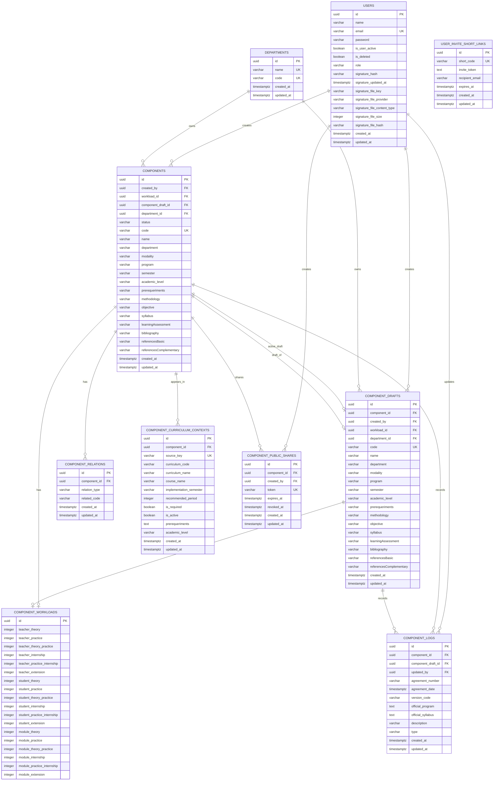

# MER do Sistema de Ementas

Este modelo registra o recorte das entidades TypeORM em 2026-07-29 e a correcao de integracao entre departamentos e componentes curriculares.

Nota de revisao (2026-11-06): este diagrama e historico. Nao inclui evolucoes posteriores, como cursos, favoritos, sessoes e historico imutavel de publicacoes (`component_versions`). Consulte as entidades e migrations da API para o esquema vigente.

Observacao importante: `components.department` e `component_drafts.department` continuam existindo como texto denormalizado para exibicao e compatibilidade com dados legados, mas a relacao canonica agora e `department_id -> departments.id`.

## Regras de integridade relevantes

- `departments.name` e `departments.code` possuem unicidade normalizada por migration.
- `components.department_id` referencia `departments.id` com `ON DELETE SET NULL`.
- `component_drafts.department_id` referencia `departments.id` com `ON DELETE SET NULL`.
- Novos componentes criados manualmente, rascunhos, aprovacoes e imports SIGAA/SIAC passam a resolver/criar `Department` e preencher `department_id`.
- A migration `1782000000000-backfillComponentDepartments` reconcilia dados de producao: cria departamentos faltantes a partir dos textos existentes e preenche `department_id`.
- `component_curriculum_contexts` representa os contextos de matriz curricular extraidos do SIGAA e pertence a `components`.
